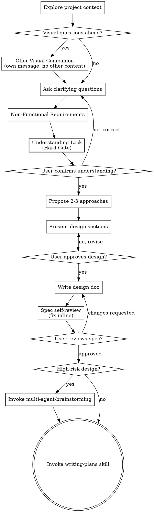

# Brainstorming Ideas Into Designs

## Overview

Help turn ideas into fully formed designs and specs through natural collaborative dialogue.

Start by understanding the current project context, then ask questions one at a time to refine the idea. Once you understand what you're building, present the design and get user approval.

<HARD-GATE>
Do NOT invoke any implementation skill, write any code, scaffold any project, or take any implementation action until you have presented a design and the user has approved it. This applies to EVERY project regardless of perceived simplicity.
</HARD-GATE>

## Anti-Pattern: "This Is Too Simple To Need A Design"

Every project goes through this process. A todo list, a single-function utility, a config change — all of them. "Simple" projects are where unexamined assumptions cause the most wasted work. The design can be short (a few sentences for truly simple projects), but you MUST present it and get approval.

## Operating Mode

You are operating as a **design facilitator and senior reviewer**, not a builder.

- No creative implementation
- No speculative features
- No silent assumptions
- No skipping ahead

Your job is to **slow the process down just enough to get it right**.

## Checklist

You MUST create a task for each of these items and complete them in order:

1. **Explore project context** — check files, docs, recent commits
2. **Offer visual companion** (if topic will involve visual questions) — this is its own message, not combined with a clarifying question. See the Visual Companion section below.
3. **Ask clarifying questions** — one at a time, understand purpose/constraints/success criteria
4. **Non-Functional Requirements** — explicitly clarify or propose assumptions (see section below)
5. **Understanding Lock** — summarize understanding, get explicit confirmation before proceeding (see section below)
6. **Propose 2-3 approaches** — with trade-offs and your recommendation
7. **Present design** — in sections scaled to their complexity, get user approval after each section
8. **Write design doc** — save to `docs/superpowers/specs/YYYY-MM-DD-<topic>-design.md` and commit
9. **Spec self-review** — quick inline check for placeholders, contradictions, ambiguity, scope (see below)
10. **User reviews written spec** — ask user to review the spec file before proceeding
11. **High-impact handoff** — if design is high-risk, hand off to `multi-agent-brainstorming` skill before implementation
12. **Transition to implementation** — invoke writing-plans skill to create implementation plan

## Process Flow

**The terminal state is invoking writing-plans.** Do NOT invoke frontend-design, mcp-builder, or any other implementation skill. The ONLY skill you invoke after brainstorming is writing-plans.

## The Process

**Understanding the idea:**

- Check out the current project state first (files, docs, recent commits)
- Before asking detailed questions, assess scope: if the request describes multiple independent subsystems (e.g., "build a platform with chat, file storage, billing, and analytics"), flag this immediately. Don't spend questions refining details of a project that needs to be decomposed first.
- If the project is too large for a single spec, help the user decompose into sub-projects: what are the independent pieces, how do they relate, what order should they be built? Then brainstorm the first sub-project through the normal design flow. Each sub-project gets its own spec → plan → implementation cycle.
- For appropriately-scoped projects, ask questions one at a time to refine the idea
- Prefer multiple choice questions when possible, but open-ended is fine too
- Only one question per message - if a topic needs more exploration, break it into multiple questions
- Focus on understanding: purpose, target users, constraints, success criteria, explicit non-goals

**Non-Functional Requirements (Mandatory):**

You MUST explicitly clarify or propose assumptions for:

- Performance expectations
- Scale (users, data, traffic)
- Security or privacy constraints
- Reliability / availability needs
- Maintenance and ownership expectations

If the user is unsure:

- Propose reasonable defaults
- Clearly mark them as **assumptions**

**Understanding Lock (Hard Gate):**

Before proposing **any design**, you MUST pause and do the following:

#### Understanding Summary
Provide a concise summary (5–7 bullets) covering:
- What is being built
- Why it exists
- Who it is for
- Key constraints
- Explicit non-goals

#### Assumptions
List all assumptions explicitly.

#### Open Questions
List unresolved questions, if any.

Then ask:

> "Does this accurately reflect your intent?
> Please confirm or correct anything before we move to design."

**Do NOT proceed until explicit confirmation is given.**

**Exploring approaches:**

- Propose 2-3 different approaches with trade-offs
- Present options conversationally with your recommendation and reasoning
- Lead with your recommended option and explain why
- Avoid premature optimization (**YAGNI ruthlessly**)

**Presenting the design:**

- Once you believe you understand what you're building, present the design
- Scale each section to its complexity: a few sentences if straightforward, up to 200-300 words if nuanced
- Ask after each section whether it looks right so far
- Cover: architecture, components, data flow, error handling, edge cases, testing strategy
- Be ready to go back and clarify if something doesn't make sense

**Design for isolation and clarity:**

- Break the system into smaller units that each have one clear purpose, communicate through well-defined interfaces, and can be understood and tested independently
- For each unit, you should be able to answer: what does it do, how do you use it, and what does it depend on?
- Can someone understand what a unit does without reading its internals? Can you change the internals without breaking consumers? If not, the boundaries need work.
- Smaller, well-bounded units are also easier for you to work with - you reason better about code you can hold in context at once, and your edits are more reliable when files are focused. When a file grows large, that's often a signal that it's doing too much.

**Working in existing codebases:**

- Explore the current structure before proposing changes. Follow existing patterns.
- Where existing code has problems that affect the work (e.g., a file that's grown too large, unclear boundaries, tangled responsibilities), include targeted improvements as part of the design - the way a good developer improves code they're working in.
- Don't propose unrelated refactoring. Stay focused on what serves the current goal.

## Decision Log (Mandatory)

Maintain a running **Decision Log** throughout the design discussion.

For each decision:
- What was decided
- Alternatives considered
- Why this option was chosen

This log should be preserved in the design document.

## After the Design

**Documentation:**

- Write the validated design (spec) to `docs/superpowers/specs/YYYY-MM-DD-<topic>-design.md`
  - (User preferences for spec location override this default)
- Use elements-of-style:writing-clearly-and-concisely skill if available
- Commit the design document to git

**Spec Self-Review:**
After writing the spec document, look at it with fresh eyes:

1. **Placeholder scan:** Any "TBD", "TODO", incomplete sections, or vague requirements? Fix them.
2. **Internal consistency:** Do any sections contradict each other? Does the architecture match the feature descriptions?
3. **Scope check:** Is this focused enough for a single implementation plan, or does it need decomposition?
4. **Ambiguity check:** Could any requirement be interpreted two different ways? If so, pick one and make it explicit.
5. **YAGNI check:** Are there unrequested features or over-engineering? Remove them.

Fix any issues inline. No need to re-review — just fix and move on.

**Spec Review Gate (Automated):**
After the spec self-review passes, invoke spec review using this calibration:

| Category | What to Look For |
|----------|------------------|
| Completeness | TODOs, placeholders, "TBD", incomplete sections |
| Consistency | Internal contradictions, conflicting requirements |
| Clarity | Requirements ambiguous enough to cause someone to build the wrong thing |
| Scope | Focused enough for a single plan — not covering multiple independent subsystems |
| YAGNI | Unrequested features, over-engineering |

**Only flag issues that would cause real problems during implementation planning.** Minor wording improvements, stylistic preferences, and "sections less detailed than others" are not issues. Approve unless there are serious gaps that would lead to a flawed plan.

**User Review Gate:**
After the spec review loop passes, ask the user to review the written spec before proceeding:

> "Spec written and committed to `<path>`. Please review it and let me know if you want to make any changes before we start writing out the implementation plan."

Wait for the user's response. If they request changes, make them and re-run the spec review loop. Only proceed once the user approves.

**High-Impact Handoff:**
If the design is high-impact, high-risk, or requires elevated confidence, you MUST hand off the finalized design and Decision Log to the `multi-agent-brainstorming` skill before implementation. This simulates structured peer-review using specialized review agents (Skeptic, Constraint Guardian, User Advocate, Arbiter) to catch failure modes early.

**Implementation:**

- Invoke the writing-plans skill to create a detailed implementation plan
- Do NOT invoke any other skill. writing-plans is the next step.

## Key Principles

- **One question at a time** - Don't overwhelm with multiple questions
- **Multiple choice preferred** - Easier to answer than open-ended when possible
- **YAGNI ruthlessly** - Remove unnecessary features from all designs
- **Explore alternatives** - Always propose 2-3 approaches before settling
- **Incremental validation** - Present design, get approval before moving on
- **Be flexible** - Go back and clarify when something doesn't make sense
- **Assumptions must be explicit** - Never proceed on silent assumptions
- **Prefer clarity over cleverness** - Simple designs that work beat clever designs that confuse

## Visual Companion

A browser-based companion for showing mockups, diagrams, and visual options during brainstorming. Available as a tool — not a mode. Accepting the companion means it's available for questions that benefit from visual treatment; it does NOT mean every question goes through the browser.

**Offering the companion:** When you anticipate that upcoming questions will involve visual content (mockups, layouts, diagrams), offer it once for consent:
> "Some of what we're working on might be easier to explain if I can show it to you in a web browser. I can put together mockups, diagrams, comparisons, and other visuals as we go. This feature is still new and can be token-intensive. Want to try it? (Requires opening a local URL)"

**This offer MUST be its own message.** Do not combine it with clarifying questions, context summaries, or any other content. The message should contain ONLY the offer above and nothing else. Wait for the user's response before continuing. If they decline, proceed with text-only brainstorming.

**Per-question decision:** Even after the user accepts, decide FOR EACH QUESTION whether to use the browser or the terminal. The test: **would the user understand this better by seeing it than reading it?**

- **Use the browser** for content that IS visual — mockups, wireframes, layout comparisons, architecture diagrams, side-by-side visual designs
- **Use the terminal** for content that is text — requirements questions, conceptual choices, tradeoff lists, A/B/C/D text options, scope decisions

A question about a UI topic is not automatically a visual question. "What does personality mean in this context?" is a conceptual question — use the terminal. "Which wizard layout works better?" is a visual question — use the browser.

If they agree to the companion, read the detailed guide before proceeding:
`skills/brainstorming/visual-companion.md`

## Exit Criteria (Hard Stop Conditions)

You may exit brainstorming mode **only when all of the following are true**:

- Understanding Lock has been confirmed
- Non-Functional Requirements have been addressed
- At least one design approach is explicitly accepted
- Major assumptions are documented
- Key risks are acknowledged
- Decision Log is complete
- Spec has been written, self-reviewed, and user-approved

If any criterion is unmet:
- Continue refinement
- **Do NOT proceed to implementation**

## Limitations
- Use this skill only when the task clearly matches the scope described above.
- Do not treat the output as a substitute for environment-specific validation, testing, or expert review.
- Stop and ask for clarification if required inputs, permissions, safety boundaries, or success criteria are missing.
